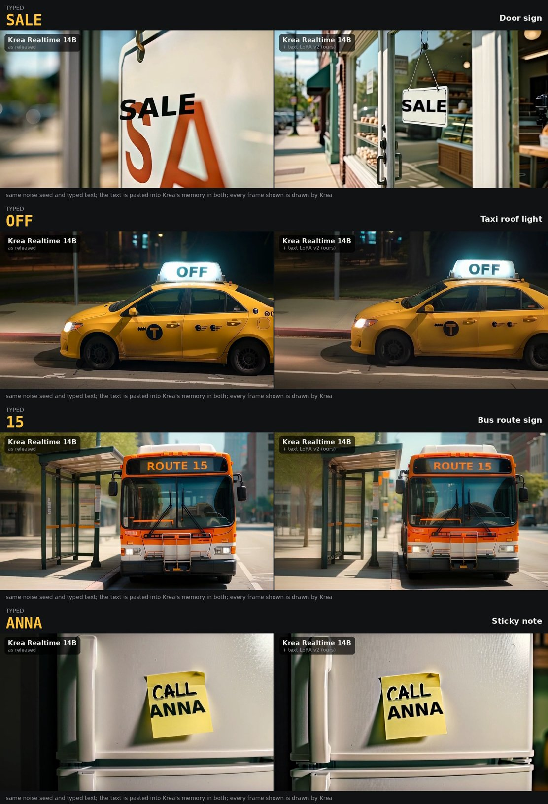
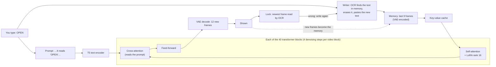

# Typed text that holds in Krea Realtime 14B

Real-time video models drift on text: a calculator typed "23476" shows "29476" a second later, and a sign flips its
letters. This repo shows a way to make [Krea Realtime 14B](https://github.com/krea-ai/realtime-video) keep the text you
type, on calculators, signs, screens and notes, at no cost in speed:

1. **Write the text into the model's memory.** Krea draws each new block of frames from a memory of recent frames. A
   writer finds the text in that memory with OCR, erases it and pastes the typed text in a plain font.
2. **A small LoRA makes the model copy the memory's text.** Rank-16 adapters on self-attention, trained on Krea's own
   frames, merged into the weights.
3. **A lock checks every block.** If the newest frame reads wrong, the memory is written again.

Every frame shown is drawn by Krea. The typed text reaches it only through the prompt and the memory.

*Base Krea (left) vs Krea + LoRA v2 (right) on four surfaces the LoRA never trained on. Video:
[media/text_surfaces_v2_s101.mp4](media/text_surfaces_v2_s101.mp4) (62 s).*

## How it works

A fuller diagram with the measurements is in [docs/diagram.html](docs/diagram.html).

## What we found

### Where the digit lives inside the model

A linear probe on the hidden state at each digit's position on a calculator display. It was tested on numbers the probe
never saw; chance is 2% ([results/scores/probe_digits.json](results/scores/probe_digits.json)).

| | t = 1000 (noise) | 909 | 714 | 0 |
|---|---|---|---|---|
| block 10 | 23% | 52% | 73% | **81%** |
| block 20 | **45%** | 61% | 70% | 68% |
| block 30 | 30% | 46% | 56% | 54% |
| block 39 | 31% | 43% | 52% | 51% |

- **It's local.** The same probe on the keypad below the display reads 4–6%.
- **It's strongest in blocks 10–20**, and already present at the first denoising step, while the frame is still pure
  noise. It comes from the memory and the prompt.
- **One code is shared across positions.** A probe trained on the left three digits reads the right two at 82%.
- **Errors happen inside the model.** When Krea drew a wrong digit, the hidden state held the drawn digit (57%), not the
  typed one (25%), before decoding.

### The LoRA

- **Size:** rank 16, on self-attention's fused q/k/v and output projections in all 40 blocks: 19.7M parameters, 0.14%
  of the model.
- **Training:** on Krea's own frames. Where some frames of a block drew the number right, their display was copied onto
  the wrong frames, and the model learned to produce that. The display counts fully in the loss, the rest of the frame
  at 0.1.
- **Two rounds:** the pilot (3000 steps), then v2, trained on the pilot's own remaining mistakes (1500 steps, without the
  final denoising step, which teaches nothing).
- **Speed:** merged into the bf16 weights (98% of the update survives rounding), it costs no time: 3.45–3.65 s per
  12-frame block vs 3.75–3.86 s for base, on one RTX PRO 6000.

Calculators, typed numbers never trained on, 3 noise seeds. Share of frames right by OCR / a 7-segment reader:

| Start image | Base | v2 |
|---|---|---|
| s1 (trained on) | 56 / 61% | 86 / 94% |
| s0 (never trained on) | 52 / 60% | 87 / 93% |
| s2 (added in round 2) | 49 / 30% | 77 / 65% |

([results/scores/lora_eval*.json](results/scores))

### Letters and other surfaces

The same loop with the general writer, on five surfaces the LoRA never saw. The LoRA was trained only on calculator
digits. Share of frames right by OCR, 2 noise seeds, 10 typed values each
([results/scores/tscene_*.json](results/scores)):

| Surface | Typed | Base | v2 |
|---|---|---|---|
| Car dashboard screen | numbers | 95% | 94% |
| Bus LED route sign | numbers | 82% | 94% |
| Hanging door sign | words | 52% | **100%** |
| Taxi roof light | words | 82% | 91% |
| Sticky note | names | 100% | 100% |
| **Mean** | | **82%** | **96%** |

With the text written into memory, base Krea already keeps it on most surfaces. v2 adds on three of five and holds the
scene steadier. On the door sign, base's camera dives into the sign and the scene breaks up, while v2 keeps it in view
with every word right.

### What did not work

- **The prompt alone.** With nothing written into memory, neither base nor v2 writes the typed number (4–5% right on five
  scenes). v2 holds the old number more than base: 27–57% of frames vs 4–28%
  ([results/scores/pscene_*.json](results/scores)). The LoRA learned "keep what the memory shows", not "read the prompt".
- **A klein-styled memory** and a frame-by-frame font paste were earlier steps. The first gave natural digits that the
  model still changed; the second gave correct digits that looked pasted.

### Motion

The LoRA costs some motion. It pans when asked, but it resists zooming, and on the simplest scene it holds the frame
still ([results/scores/motion_*.json](results/scores), [mscene_*.json](results/scores)):

| Scene, camera prompt | Zoom per 13-block segment: base / v2 | Frame-to-frame change: base / v2 | Text right: base / v2 |
|---|---|---|---|
| Taxi, "slowly pushes in" | 1.06 / 1.01 | 3.0 / 2.5 | 83 / 80% |
| Sticky note, "slowly pushes in" | 1.08 / 1.00 | 4.5 / **0.4** | 62 / 100% |
| Bus, "slowly pushes in towards it" | 1.12 / 1.03 | 4.9 / 4.8 | 82 / 94% |
| Door sign, "slowly pans to the right" | sideways 12 / 99 px | 8.2 / 4.6 | 52 / 100% |

On the sticky note, v2's 100% comes with a frozen frame. The training shots were static calculator scenes with "steady
shot" prompts, and the loss held the rest of the frame close to Krea's own output; the next round needs moving-camera
examples.

## Limits

- One model (Krea Realtime 14B) and one GPU type. A 12-frame block (0.75 s of video at 16 fps) takes about 3.5 s on an
  RTX PRO 6000 with standard attention, so our runs are not real-time on that GPU.
- Flat surfaces with one line of text. Curved, glowing, handwritten-in-scene and multi-line text are not tested.
- OCR and a 7-segment reader score the frames; both misread some fonts. The tables count the reader's verdicts, checked
  by eye on samples.
- Two or three noise seeds per condition.

## Repository

| Path | What |
|---|---|
| `textbench/paste_writer.py` | the general writer: OCR find, ORB tracking, two-colour erase and inpaint, paste |
| `textbench/write_lcd.py`, `seg7.py` | the 7-segment writer and reader for calculator LCDs |
| `textbench/lora_targets.py` | training targets: a block's wrong frames get the display of its right frames |
| `runner/gen_krea.py` | the live loop (writers, lock, LoRA attach or merge, sample collection, probe hooks) |
| `runner/lora_train.py` | the LoRA trainer (one random denoising step per sample, weighted x0 loss) |
| `runner/feature_probe.py`, `scripts/probe_digits.py` | the hidden-state probe |
| `runner/live_server.py`, `live_page.html` | the live typing page |
| `runner/configs.yaml` | every run's settings (e.g. `tscene_door`, `lora_v2`, `lora_eval_v2_s0`) |
| `scripts/score_text.py`, `score_replay.py`, `motion_check.py` | scoring |
| `results/scores/` | the numbers in this README |
| `docs/` | the pilot plan, the general-text plan, the diagram |

The code runs inside Krea's environment: clone [krea-ai/realtime-video](https://github.com/krea-ai/realtime-video) into
`third_party/krea-realtime` and download its weights. Krea's code and weights carry their own licence (CC BY-NC-SA 4.0
for the code); this repo contains none of them. Runs used one spot RTX PRO 6000 on Google Cloud; the cloud scripts are
not included.

This repo is licensed under CC BY-NC-SA 4.0 ([LICENSE.md](LICENSE.md)), matching Krea's code. Fonts: DSEG7 Classic
(SIL Open Font License) and DejaVu Sans (DejaVu Fonts licence), in `assets/fonts`, under their own licences.
