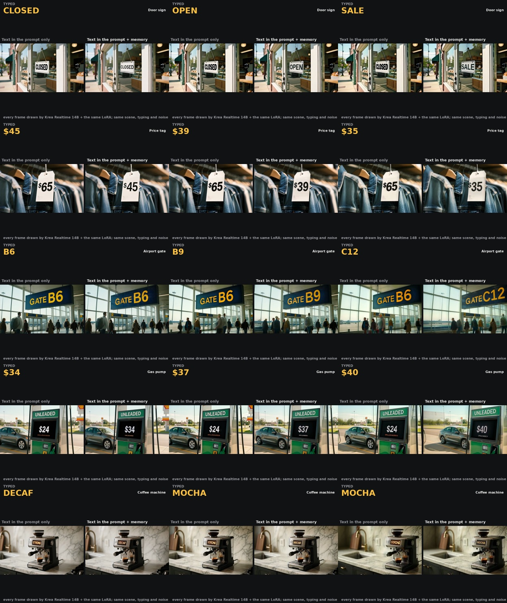
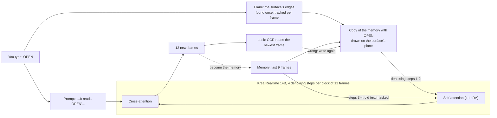

# Typed text that holds in Krea Realtime 14B

Runway's Solaris write-up: "Fully real-time generated text remains an open challenge." Type a new gate number into
[Krea Realtime 14B](https://github.com/krea-ai/realtime-video) and the sign keeps saying "GATE B6". This repo makes the
text you type appear on the surface and hold while the camera moves: signs, price tags, screens, words and digits.
Every frame is drawn by Krea; nothing is overlaid.

*Same model (Krea + the same LoRA), noise seed and typing, five scenes the LoRA never saw. Left: the typed text in the
prompt only. Right: also written into the model's memory. Videos: [media/krea_text_before_after.mp4](media/krea_text_before_after.mp4)
(40 s, side by side), [media/krea_text_reel.mp4](media/krea_text_reel.mp4) (36 s).*

## Results

Share of frames where OCR finds the typed text (160 frames per scene, 10 typed changes, noise seed 101, camera moving;
[results/scores/](results/scores), `*_contains.json`):

| Scene | Prompt only, base Krea | Prompt only, + LoRA | Memory write, no LoRA | Memory write + LoRA |
|---|---|---|---|---|
| Door sign (words) | 5% | 4% | 61% | **99%** |
| Price tag | 4% | 4% | 57% | 53%* |
| Gas pump display | 31% | 4% | **100%** | 99% |
| Airport gate sign | 4% | 4% | 91% | **92%** |
| Coffee machine label | 11% | 12% | **78%** | 73% |
| **Mean** | **11%** | **5%** | **77%** | **83%** |

\*OCR often misses the small raised "$" Krea draws on the tag. Files: `before_eval_*`, `pairA_eval_*`, `ablate_eval_*`,
`fix5_eval_*` (price tag: `fix6_eval_price_tag`, the same method with the lock fix below).

- **The prompt alone does not change text already on screen** (5-11%): the old text stays (door: CLOSED in 100% of
  frames with the LoRA).
- **The memory write is the method** (77% without the LoRA). The LoRA adds 6 points on the mean, almost all on the door
  sign, where base Krea's camera also dives into the sign on this seed; on the price tag and coffee machine it is
  slightly lower.
- **Speed** (one RTX PRO 6000, per 12-frame block): 3.3 s for a plain block; a block where the text changes takes
  4.3 s plus the write (up to 1.8 s, 90th percentile); the lock adds about 0.15 s to every block. The merged LoRA costs
  nothing (3.31 vs 3.29 s).

## How it works

1. **Find the plane** (`textbench/paste_writer.py`, `PlaneWriter`). On the first frame OCR finds the text; the surface's
   own border edges (line segments near the text, with the surface's colour inside) give its plane, the text's height
   and font width. An ORB tracker follows the text, and the plane moves with it.
2. **Show the new text for the first steps only** (`runner/gen_krea.py`, `live_paste_mode: early`). Krea draws each
   block from a memory of its last frames. When the text changes, the first 2 of the 4 denoising steps run on a copy of
   the memory with the old text erased and the new text drawn on the plane; the last 2 run on the real memory, its
   key-value cache rebuilt, with the old text's tokens masked in each frame. The memory itself is not edited: the model
   draws the letters in the scene's light and perspective. After feature injection in image editing (Plug-and-Play,
   Tumanyan et al. 2023).
3. **Lock.** OCR reads every new block; if the text is wrong, the next block is written again.
4. **LoRA** (optional, +6 points): rank 16 on self-attention, 0.14% of the weights, trained on Krea's own frames to keep
   what its memory shows, merged into the weights.

## Limits

- One noise seed for these tables, scored by OCR (it misreads some fonts and the small "$").
- **Text stays where it is on screen.** On a long pan the price tag moves on and the number lags behind it, then slips
  off the tag (the videos show the stretches where it holds). Erasing the copies left on the background
  (`live_paste_strays`, tried) did not fix it.
- Krea restarts from the first frame every 13 blocks (it drifts away from the scene after ~30 blocks).
- Flat surfaces with one line of text. One model and one GPU type; not real-time on that GPU (3.3 s per 0.75 s of video).

## Earlier findings (first writer, 17 Nov)

The first version pasted the text into the memory in a plain font (it held, but looked pasted). These
findings are from that version.

### Where the digit lives inside the model

A linear probe on the hidden state at each digit's position on a calculator display. It was tested on numbers the probe
never saw; chance is 2% ([results/scores/probe_digits.json](results/scores/probe_digits.json)).

| | t = 1000 (noise) | 909 | 714 | 0 |
|---|---|---|---|---|
| block 10 | 23% | 52% | 73% | **81%** |
| block 20 | **45%** | 61% | 70% | 68% |
| block 30 | 30% | 46% | 56% | 54% |
| block 39 | 31% | 43% | 52% | 51% |

- **It's local.** The same probe on the keypad below the display reads 4–6%.
- **It's strongest in blocks 10–20**, and already present at the first denoising step, while the frame is still pure
  noise. It comes from the memory and the prompt.
- **One code is shared across positions.** A probe trained on the left three digits reads the right two at 82%.
- **Errors happen inside the model.** When Krea drew a wrong digit, the hidden state held the drawn digit (57%), not the
  typed one (25%), before decoding.

### The LoRA

- **Size:** rank 16, on self-attention's fused q/k/v and output projections in all 40 blocks: 19.7M parameters, 0.14%
  of the model.
- **Training:** on Krea's own frames. Where some frames of a block drew the number right, their display was copied onto
  the wrong frames, and the model learned to produce that. The display counts fully in the loss, the rest of the frame
  at 0.1.
- **Two rounds:** the pilot (3000 steps), then v2, trained on the pilot's own remaining mistakes (1500 steps, without the
  final denoising step, which teaches nothing).
- **Speed:** merged into the bf16 weights (98% of the update survives rounding), it costs no time: 3.45–3.65 s per
  12-frame block vs 3.75–3.86 s for base, on one RTX PRO 6000.

Calculators, typed numbers never trained on, 3 noise seeds. Share of frames right by OCR / a 7-segment reader:

| Start image | Base | v2 |
|---|---|---|
| s1 (trained on) | 56 / 61% | 86 / 94% |
| s0 (never trained on) | 52 / 60% | 87 / 93% |
| s2 (added in round 2) | 49 / 30% | 77 / 65% |

([results/scores/lora_eval*.json](results/scores))

### Letters and other surfaces

The same loop with the general writer, on five surfaces the LoRA never saw. The LoRA was trained only on calculator
digits. Share of frames right by OCR, 2 noise seeds, 10 typed values each
([results/scores/tscene_*.json](results/scores)):

| Surface | Typed | Base | v2 |
|---|---|---|---|
| Car dashboard screen | numbers | 95% | 94% |
| Bus LED route sign | numbers | 82% | 94% |
| Hanging door sign | words | 52% | **100%** |
| Taxi roof light | words | 82% | 91% |
| Sticky note | names | 100% | 100% |
| **Mean** | | **82%** | **96%** |

With the text written into memory, base Krea already keeps it on most surfaces. v2 adds on three of five and holds the
scene steadier. On the door sign, base's camera dives into the sign and the scene breaks up, while v2 keeps it in view
with every word right.

### What did not work

- **The prompt alone.** With nothing written into memory, neither base nor v2 writes the typed number (4–5% right on five
  scenes). v2 holds the old number more than base: 27–57% of frames vs 4–28%
  ([results/scores/pscene_*.json](results/scores)). The LoRA learned "keep what the memory shows", not "read the prompt".
- **A klein-styled memory** and a frame-by-frame font paste were earlier steps. The first gave natural digits that the
  model still changed; the second gave correct digits that looked pasted.

### Motion

The LoRA costs some motion. It pans when asked, but it resists zooming, and on the simplest scene it holds the frame
still ([results/scores/motion_*.json](results/scores), [mscene_*.json](results/scores)):

| Scene, camera prompt | Zoom per 13-block segment: base / v2 | Frame-to-frame change: base / v2 | Text right: base / v2 |
|---|---|---|---|
| Taxi, "slowly pushes in" | 1.06 / 1.01 | 3.0 / 2.5 | 83 / 80% |
| Sticky note, "slowly pushes in" | 1.08 / 1.00 | 4.5 / **0.4** | 62 / 100% |
| Bus, "slowly pushes in towards it" | 1.12 / 1.03 | 4.9 / 4.8 | 82 / 94% |
| Door sign, "slowly pans to the right" | sideways 12 / 99 px | 8.2 / 4.6 | 52 / 100% |

On the sticky note, v2's 100% comes with a frozen frame. The training shots were static calculator scenes with "steady
shot" prompts, and the loss held the rest of the frame close to Krea's own output; the next round needs moving-camera
examples.

## Repository

| Path | What |
|---|---|
| `textbench/paste_writer.py` | the writer: OCR find, ORB tracking, the surface plane (`PlaneWriter`), erase and inpaint |
| `textbench/write_lcd.py`, `seg7.py` | the 7-segment writer and reader for calculator LCDs |
| `textbench/lora_targets.py` | training targets: a block's wrong frames get the display of its right frames |
| `runner/gen_krea.py` | the live loop (writers, early-steps write, lock, LoRA attach or merge, probe hooks) |
| `runner/lora_train.py` | the LoRA trainer (one random denoising step per sample, weighted x0 loss) |
| `runner/feature_probe.py`, `scripts/probe_digits.py` | the hidden-state probe |
| `runner/live_server.py`, `live_page.html` | the live typing page |
| `runner/configs.yaml` | every run's settings (e.g. `replay_E2P_lora4_door`, `fix5_eval_door`, `before_eval_door`) |
| `scripts/score_text.py`, `contains_rate.py`, `score_replay.py`, `motion_check.py` | scoring |
| `scripts/scene_reel.py`, `before_after.py` | the videos |
| `results/scores/` | the numbers in this README |
| `docs/` | the pilot plan, the general-text plan, the diagram |

The code runs inside Krea's environment: clone [krea-ai/realtime-video](https://github.com/krea-ai/realtime-video) into
`third_party/krea-realtime` and download its weights. Krea's code and weights carry their own licence (CC BY-NC-SA 4.0
for the code); this repo contains none of them. Runs used one spot RTX PRO 6000 on Google Cloud; the cloud scripts are
not included.

This repo is licensed under CC BY-NC-SA 4.0 ([LICENSE.md](LICENSE.md)), matching Krea's code. Fonts: DSEG7 Classic
(SIL Open Font License) and DejaVu Sans (DejaVu Fonts licence), in `assets/fonts`, under their own licences.
